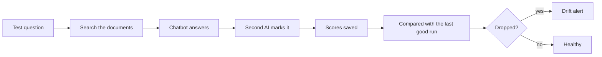

# EvalGuard AI

**A smoke alarm for AI chatbots that read documents.**

Chatbots that answer from a company's own documents (called RAG chatbots) can be right today and quietly wrong after a document, a model, or an instruction changes. EvalGuard keeps asking such a chatbot the same test questions, has a second AI mark every answer, saves the marks, and warns you when they slip.

It covers 8 industries: Education, Healthcare, Banking and Finance, Legal, E-commerce, IT Support, HR, and Travel and Hospitality. All reference documents are synthetic, so high scores do not certify clinical, regulatory or legal compliance.

## What you can do with it

- **Measure** each answer on five scores: faithfulness, relevance, search quality, safety and speed.
- **Spot drops** automatically by comparing every run with the last comparable one (KS statistical test).
- **Compare prompts** (instruction wordings) or **compare AI models** on the same questions, side by side.
- **Test trick questions**: out-of-scope questions and hidden instructions (prompt injection).
- **Add your own test questions** and upload your own documents.
- **Sign in securely** with Clerk. Every API call is checked.

New to these words? Open [docs/DEMO_EXPLAINED.html](docs/DEMO_EXPLAINED.html) in a browser for a picture-based explanation.

## Documentation

| Read this | When |
| --- | --- |
| [docs/COMMANDS.md](docs/COMMANDS.md) | You want a command to copy: setup, start, test, evaluate, fix problems |
| [docs/USER_GUIDE.md](docs/USER_GUIDE.md) | You want to know what each page does and how to do common tasks |
| [docs/TECHNICAL.md](docs/TECHNICAL.md) | You want to know how it works inside, the API, the database, or how to extend it |
| [docs/DEMO_SCRIPT.md](docs/DEMO_SCRIPT.md) | You are presenting it: a 10-minute speaking script |
| [docs/DEMO_EXPLAINED.html](docs/DEMO_EXPLAINED.html) | You want plain-language pictures of the idea |

## Quick start

You need **Python 3.11**, **Node.js 20 or newer**, [**uv**](https://docs.astral.sh/uv/), a free [**Clerk**](https://clerk.com) account, and an [**OpenRouter**](https://openrouter.ai/keys) key (free models work). Commands are for Windows PowerShell, run from this folder.

### 1. Install

```powershell
uv venv --python 3.11 .venv
uv pip install --python .venv\Scripts\python.exe -r requirements.txt

cd web
npm install
copy .env.example .env
cd ..
```

The first install is large and takes several minutes.

### 2. Settings

```powershell
copy .env.example .env
```

Open `.env` and paste your OpenRouter key after `OPENROUTER_API_KEY=`. The two model names are already filled in: one **answers**, a different one **marks**. Free model names change often, so if one stops working, pick another from <https://openrouter.ai/models?q=free>. Every setting is explained in the [technical guide](docs/TECHNICAL.md#13-settings-reference).

`.env` is private and ignored by git. Never commit it.

### 3. Sign-in (Clerk)

```powershell
cd web
npx -y clerk@latest auth login                       # opens a browser
npx -y clerk@latest link --app <your_clerk_app_id>   # the id is in the Clerk dashboard
npx -y clerk@latest env pull                         # writes web\.env.local
cd ..
```

If Clerk asks for a phone number when you sign up and your country isn't supported on a development app, turn phone numbers off in the Clerk dashboard under User and authentication.

### 4. Run

```powershell
.\scripts\dev.ps1
```

This opens two windows: the API (port 8000) and the web app (port 3000). Open <http://localhost:3000>, create an account, and sign in.

### 5. Your first evaluation

1. In the app, open **Evaluate**.
2. Choose a domain, set **Limit questions** to `5` for a quick try, and press **Start evaluation**.
3. When it finishes, open **Runs** and click the run to read each question, answer and the judge's reasons.

A full domain (30 questions) takes about 10 minutes with free models, so use the limit while you're exploring. Run it twice and the second run is automatically compared with the first.

## Everyday commands

| I want to | Command |
| --- | --- |
| Start everything | `.\scripts\dev.ps1` |
| Run one domain from the terminal | `.venv\Scripts\python.exe scripts\run_eval.py --domain hr` |
| Run all domains | `.venv\Scripts\python.exe scripts\run_eval.py --all-domains` |
| Make a fake quality drop for a demo | `.venv\Scripts\python.exe scripts\simulate_drift.py --domain hr` |
| Run the tests | `.venv\Scripts\python.exe -m pytest tests -q` |
| Check the question files | `py -I scripts\validate_dataset.py` |
| Check the web code | `cd web; npx tsc --noEmit; npm run lint` |

Everything else, including stopping the servers and fixing common problems, is in [docs/COMMANDS.md](docs/COMMANDS.md).

## How it fits together



The web app (Next.js) talks to the API (FastAPI), which runs evaluations in the background and stores results in a small SQLite file. More detail and a folder map: [docs/TECHNICAL.md](docs/TECHNICAL.md).

## Project layout

```text
api/            The API (routes and background jobs)
evalguard/      The core: search, answering, marking, drift, storage
data/           Documents and test questions for the 8 domains
scripts/        Command-line tools (run_eval, simulate_drift, validate_dataset, dev.ps1)
tests/          Automated tests
web/            The web app
docs/           Guides and demo material
```

## Honest limits

- Runs are started by hand. Scheduled runs and alerts are the next step.
- 30 standard questions per domain is a small sample, so small score changes can be luck. The app says so.
- The trick-question safety check looks for phrases, so a clever answer could slip past it.
- Free AI models are limited per day and change over time. If you hit the daily limit, wait for 00:00 UTC, add credit on OpenRouter, or switch `LLM_PROVIDER` in `.env`.
- Without a real AI key the app uses a fake "mock" judge with fixed scores. It labels these clearly and leaves them out of the averages.

## Testing

```powershell
.venv\Scripts\python.exe -m pytest tests -q
```

59 tests run without internet or a real AI. They cover scoring, drift, safe comparison rules, sign-in token checks, prompts, experiments, custom questions and browser access rules (CORS).
