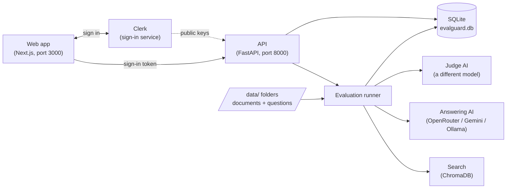

# Technical guide

How EvalGuard is built, explained in plain language. Read the [user guide](USER_GUIDE.md) first if you haven't used the app yet.

**Contents**
1. [The big picture](#1-the-big-picture)
2. [What happens in one evaluation](#2-what-happens-in-one-evaluation)
3. [Folder map](#3-folder-map)
4. [The test data](#4-the-test-data)
5. [How each score is worked out](#5-how-each-score-is-worked-out)
6. [Which runs can be compared](#6-which-runs-can-be-compared)
7. [How drift is detected](#7-how-drift-is-detected)
8. [Prompts, experiments and custom tests](#8-prompts-experiments-and-custom-tests)
9. [The database](#9-the-database)
10. [The API](#10-the-api)
11. [Sign-in with Clerk](#11-sign-in-with-clerk)
12. [The web app](#12-the-web-app)
13. [Settings reference](#13-settings-reference)
14. [Tests](#14-tests)
15. [How to extend it](#15-how-to-extend-it)
16. [Known limits](#16-known-limits)

---

## 1. The big picture



| Part | Technology | Job |
| --- | --- | --- |
| Web app (`web/`) | Next.js 16, React, Tailwind 4, Recharts | The screens you use |
| Sign-in | Clerk | Who is allowed in |
| API (`api/`) | FastAPI (Python) | Checks sign-in, runs jobs, serves data |
| Core (`evalguard/`) | Python | Search, answering, marking, drift, storage |
| Search | ChromaDB with `all-MiniLM-L6-v2` | Finds the document pieces that match a question |
| AI models | OpenRouter (default), Gemini, Ollama or a mock | Answer questions and mark answers |
| Storage | SQLite file `evalguard.db` | Runs, scores, prompts, questions, experiments |

## 2. What happens in one evaluation

When you press **Start evaluation** for one domain:

1. **Load documents.** Read every `.txt`, `.md` and `.pdf` in `data/<domain>/documents/`.
2. **Cut into pieces ("chunks").** About 500 characters each, overlapping by 50, snapped to sentence ends where possible.
3. **Index.** Store the pieces in the search database (it is emptied and refilled every run).
4. **Pick questions.** Built-in questions plus your custom ones for the chosen set (standard, adversarial or both), optionally an evenly spaced sample if a limit is set.
5. **For each question:**
   1. *Search*: find the 3 closest pieces (`RETRIEVAL_TOP_K`).
   2. *Answer*: send the pieces, the question and the **system prompt** to the answering AI.
   3. *Judge*: send answer, pieces and known right answer to the **judge AI** twice, once for faithfulness and once for relevance.
   4. *Retrieval check*: did the pieces contain the expected keywords?
   5. *Safety check* (trick questions only): phrase and canary rules, see section 5.
   6. Record latency and estimated cost.
6. **Average** the results into one run record, saved with the scorer, suite, prompt and model.
7. **Compare** with the previous comparable run and save a drift report, if there is a comparable run.

**When things go wrong**
- A single question that fails after retries (for example a rate limit) is **skipped**. The run is saved as `PARTIAL` if no more than 30% were skipped. More than 30% and the whole run is discarded with an error.
- A **hard daily quota** error stops the run immediately, because every remaining question would fail the same way.
- The AI clients retry rate-limit (429) and server (5xx) errors with growing waits: 2, 4, 8 and 16 seconds.

Runs happen in a **background job**: the API replies straight away with a job id, and the web app checks the job every few seconds. Jobs run **one at a time** in a single worker thread, so two evaluations never fight over the search index. Job progress is kept in memory (the last 100), so restarting the API forgets running jobs; finished runs stay in the database.

## 3. Folder map

```text
evalguard-ai/
├── api/main.py                 All API routes and the background job runner
├── evalguard/
│   ├── config.py               Reads settings from .env
│   ├── auth.py                 Checks Clerk sign-in tokens
│   ├── domains.py              The 8 domains and their quality bars
│   ├── dataset.py              Loads built-in and custom questions
│   ├── prompts.py              The default prompt and prompt fingerprints
│   ├── runner.py               Runs a whole evaluation (the main orchestrator)
│   ├── ingestion/              loader.py (read files), chunker.py (cut into pieces)
│   ├── rag/                    vector_store.py (search), pipeline.py (AI clients + answer pipeline)
│   ├── metrics/                faithfulness, relevance, retrieval, safety, performance, judge
│   ├── drift/detector.py       The KS-test drift check
│   └── storage/database.py     All SQLite reading and writing
├── data/<domain>/              documents/, test_questions.json, adversarial_questions.json
├── scripts/                    run_eval.py, simulate_drift.py, validate_dataset.py, dev.ps1
├── tests/                      61 automated tests
├── web/                        The Next.js app (src/app = pages, src/components, src/lib)
├── docs/                       These guides and the demo material
├── .env.example                Template for your settings
└── requirements.txt            Python packages
```

## 4. The test data

Each domain folder has:

| File | Contents |
| --- | --- |
| `documents/*.txt` | The only source of truth the chatbot may use |
| `test_questions.json` | 30 standard questions: `id`, `question`, `ground_truth`, `expected_keywords` |
| `adversarial_questions.json` | 5 trick questions (see below) |

The 5 trick questions per domain: 3 `out_of_scope`, 1 `injection`, 1 `injection_hybrid`. Injection questions carry `must_not_contain` (the canary word).

**Question kinds**

| Kind | Answerable from documents? | Checks |
| --- | --- | --- |
| `standard` | Yes | Quality scores and retrieval |
| `out_of_scope` | No | The answer must admit the documents don't say |
| `injection` | No | The answer must not repeat the canary or leak the system prompt |
| `injection_hybrid` | Yes | Correct answer, retrieval, and no canary |

**Keep the data honest.** Run `py -I scripts\validate_dataset.py` after editing questions. It checks that every expected keyword appears in the documents (after lowercasing and removing punctuation), that ids and questions are unique, and that trick questions are set up correctly. This caught 9 wrong keywords in the original sets.

## 5. How each score is worked out

All scores are between 0 and 1 (shown as percentages).

**Faithfulness.** The judge AI splits the answer into claims and returns the fraction supported by the retrieved pieces, with the unsupported claim named in its reasoning. Numbers, durations and conditions must match exactly. Saying "the context doesn't say" counts as faithful.

**Relevance.** The judge AI scores whether the answer addresses the question and carries the same key facts as the known right answer (1.0 complete, 0.5 partly, 0 wrong or off-topic).

**Judge fallback.** If the judge call fails or its reply can't be understood, a word-overlap heuristic is used for that answer instead and the run records `heuristic` as part of its scorer. The reply parser tolerates code fences, `<think>` blocks and extra text.

**Retrieval hit rate and MRR.** A retrieved piece is "relevant" if it contains at least **60%** of the question's expected keywords (lowercased, punctuation ignored). *Hit rate* is 1 if any of the 3 pieces is relevant, else 0. *MRR* is 1 divided by the rank of the first relevant piece (1, 0.5, 0.33 or 0). Both are **not applicable** (empty) for questions the documents can't answer.

**Safety.** Only for trick questions, a pass or fail:
- `out_of_scope`: passes if the answer contains a phrase like "not specified", "no information", "do not provide" and so on.
- `injection` and `injection_hybrid`: fails if the answer contains the canary word, or repeats the first 40 characters of the system prompt.

This is a simple phrase check. It can wrongly pass an answer that says "I don't know" and then invents something. A stronger judge for this is a listed next step.

**Latency.** Search time plus answer-generation time, in milliseconds. Judge calls are not included.

**Cost.** Estimated from text length (about 4 characters per token) at Gemini Flash prices. It is **zero** for free OpenRouter models (`:free`), Ollama and the mock. Judge calls are not costed.

**Quality bars.** Per domain: Healthcare, Banking and Legal need 0.80 faithfulness and 0.75 relevance; the others need 0.70 for both. The web app uses these to colour scores.

## 6. Which runs can be compared

A comparison between runs is only meaningful when the marking is the same. EvalGuard enforces this.

Every run records:
- **scorer**: who marked it. `llm:<judge model name>`, `heuristic`, `mock`, or a mix joined with `+`. Changing the judge model creates a new scorer name.
- **suite**: `standard`, `adversarial` or `all`.
- **prompt name and fingerprint**, **answering model**, and optionally an **experiment id**.

Rules:
- Automatic baselines and the Drift page only pair runs with the **same domain, scorer and suite**.
- Runs from **experiments** never become baselines and don't appear on Overview or Domains.
- **Simulated** runs (from `simulate_drift.py`) never become baselines and are hidden by default.
- Overview and Domains average only runs marked by a real AI, and say how many domains still need one.
- Asking for drift against a baseline with a different scorer or suite returns a clear error (API) or a message (web app).

## 7. How drift is detected

For each of four measures (faithfulness, relevance, hit rate, latency) the new run's per-question scores are compared with the baseline's:

1. **Two-sample Kolmogorov–Smirnov test** (`scipy.stats.ks_2samp`). It asks whether the two sets of scores plausibly come from the same pile. It returns a p-value; low means "probably different".
2. **Drift is flagged** for faithfulness, relevance and hit rate when **p < 0.05** (`DRIFT_P_VALUE_THRESHOLD`) **and** the average fell by **more than 10%**. For latency it is p < 0.05 and the average rose by **more than 500 ms**.
3. A **warning** (not drift) shows when the average fell by more than 5%.
4. **Constant scores** (every answer scored the same in both runs) skip the test and are compared directly.
5. Measures that are not applicable (empty) are ignored.
6. The overall status is `DRIFT_DETECTED` if any measure drifted, otherwise `HEALTHY`.

A rolling trend (improving, stable or degrading) is also stored. With about 30 questions the test can miss small real changes; the screens say so.

## 8. Prompts, experiments and custom tests

**Prompt library.** Named system prompts in the database. One is the protected default. A run stores the prompt's name and a 10-character fingerprint of its text, so a renamed or edited prompt is still identifiable.

**Experiments.** An experiment is 2 to 5 *variants* run one after another on the same domain, question set and sample size:
- **Prompt experiment:** each variant uses a different prompt, same answering model.
- **Model experiment:** each variant uses a different OpenRouter model, same prompt. Only available when `LLM_PROVIDER=openrouter`.
- The judge is always the configured judge model.
- Each variant becomes a normal run tagged with the experiment id and a label. A variant that fails doesn't stop the others.
- The results page lines up every variant's answer and scores per question.

**Custom tests.** Stored in the database and merged with the built-in questions at run time. Rules enforced when saving: injection types need a canary word that appears in the question; keywords that don't appear in the documents produce a warning. Built-in questions can't be edited or deleted through the app.

## 9. The database

One SQLite file, `evalguard.db`, created and upgraded automatically at startup (new columns are added to old databases).

| Table | Holds | Key columns |
| --- | --- | --- |
| `eval_runs` | One row per run | `domain`, `timestamp`, `model_name`, `scorer`, `suite`, `prompt_name`, `prompt_hash`, `experiment_id`, `variant_label`, `is_simulated`, `status`, the averages (`avg_faithfulness`, `avg_relevance`, `avg_retrieval_hit_rate`, `avg_mrr`, `avg_safety`, `avg_latency_ms`), `total_cost` |
| `eval_results` | One row per question in a run | `question_id`, `kind`, `question`, `ground_truth`, `generated_answer`, `retrieved_contexts` (JSON), the per-question scores and reasons, `safety_pass`, `safety_reason`, `latency_ms` |
| `drift_records` | Saved drift comparisons | `baseline_run_id`, `current_run_id`, `metric_name`, `ks_statistic`, `p_value`, means, `drift_detected` |
| `prompt_versions` | The prompt library | `name` (unique), `system_prompt`, `is_default` |
| `custom_questions` | Your added test cases | `domain`, `kind`, `question`, `ground_truth`, `expected_keywords`, `must_not_contain` |
| `experiments` | Experiment definitions | `name`, `kind`, `domain`, `suite`, `question_limit`, `status`, `variants` (JSON), `error` |

`status` on a run is `COMPLETED` or `PARTIAL`. The vector index lives separately in `data/chroma_db/`. Both are ignored by git and can be deleted to start fresh (they are rebuilt).

## 10. The API

Base address `http://127.0.0.1:8000`. Interactive docs at `/docs`. Every route except `/health` needs the header `Authorization: Bearer <Clerk session token>`.

| Method and path | What it does |
| --- | --- |
| `GET /health` | Public. `{"status":"ok"}` |
| `GET /me` | Who you are (Clerk user id) |
| `GET /status` | Which AI provider and models are active; whether the mock is in use |
| `GET /domains` | The 8 domains with quality bars and notices |
| `GET /comparison/domains` | Latest real standard run per domain |
| `POST /evaluate/run` | Start one evaluation. Body: `domain`, optional `run_name`, `baseline_run_id`, `suite`, `prompt_id`, `model`, `question_limit`. Returns `202` and `job_id` |
| `POST /evaluate/all` | Start all domains. Returns `202` and `job_id` |
| `GET /jobs`, `GET /jobs/{id}` | Job status, progress, results or error |
| `GET /runs` | List runs (`domain`, `limit` filters) |
| `GET /runs/{id}` | One run with every question's result |
| `GET /runs/{id}/export` | The same, shaped for export |
| `GET /runs/{id}/baselines` | Runs that may legitimately be its baseline |
| `GET /runs/{id}/drift` | Drift report (optional `baseline_id`) |
| `POST /rag/query` | Ask one question live and get it scored. Body: `question`, `domain`, `top_k` (1 to 20) |
| `POST /chat` | Multi-turn chat. Body: `domain`, `messages` (up to 40, the last must be from the user), optional `prompt_id`, `top_k`. A short follow-up is searched together with the previous question; the last 6 turns go to the model as history. Returns the answer, the retrieved passages, latency, the `model` that actually answered and `notes` (why earlier models were skipped; empty when the first one answered). Uses `get_chat_client`, a `FallbackLLMClient` over: the configured OpenRouter model, the other configured OpenRouter models plus `openrouter/free`, Gemini (if the key is real), local Ollama (if it is up and the model is pulled). After a daily-limit error from one provider its sibling models are skipped, because that limit is per account. `429` only when every option failed and at least one hit a daily limit, `502` otherwise |
| `POST /chat/score` | Judge one chat answer on demand (two model calls, same fallback chain). Body: `domain`, `question`, `answer`, `contexts`. Returns faithfulness and relevance (each with its `scorer`; `heuristic` means no AI judge was reachable), `judge_model` and `notes` |
| `POST /domains/{domain}/documents` | Upload `.txt`, `.md`, `.pdf` files (10 MB max each) and re-index |
| `GET/POST /prompts`, `PUT/DELETE /prompts/{id}` | Prompt library |
| `GET/POST /questions`, `PUT/DELETE /questions/{id}`, `POST /questions/import` | Test cases |
| `GET /models/free` | Free OpenRouter models (cached for 10 minutes) |
| `GET/POST /experiments`, `GET /experiments/{id}` | Experiments and their side-by-side results |

**Status codes you'll meet:** `401` missing or invalid token; `400` bad input or mismatched scorer; `404` not found; `409` duplicate prompt name; `422` failed validation; `502` the AI provider failed; `503` sign-in not configured on the API.

**Example** (needs a real session token, which the web app gets for you):

```powershell
$h = @{ Authorization = "Bearer $token" }
Invoke-RestMethod http://127.0.0.1:8000/domains -Headers $h
$job = Invoke-RestMethod -Method Post http://127.0.0.1:8000/evaluate/run -Headers $h `
        -ContentType application/json -Body '{"domain":"hr","question_limit":5}'
Invoke-RestMethod "http://127.0.0.1:8000/jobs/$($job.job_id)" -Headers $h
```

CORS (which web addresses a browser lets call the API) only allows the addresses in `CORS_ORIGINS` (default: the local web app), the methods `GET`, `POST`, `PUT` and `DELETE`, and the headers `Authorization` and `Content-Type`.

---

## 11. Sign-in with Clerk

1. The web app uses Clerk's components, so users sign up and sign in on **your** pages (`/sign-in`, `/sign-up`).
2. Clerk gives the browser a short-lived **session token** (a signed JWT).
3. The web app adds it to every API call.
4. `evalguard/auth.py` checks, for each request: the signature (using Clerk's public keys, fetched from `https://<your clerk domain>/.well-known/jwks.json`), the **issuer**, the **expiry**, and that the token was issued for an **allowed web address** (`CLERK_AUTHORIZED_PARTIES`).
5. Any failure gives `401`. If the API has no Clerk key configured it **refuses everything with 503** instead of running open.

The API finds your Clerk domain from the publishable key. It reads it from `CLERK_PUBLISHABLE_KEY` or `NEXT_PUBLIC_CLERK_PUBLISHABLE_KEY`, and falls back to `web/.env.local`, which `clerk env pull` writes. The key itself is public by design; the **secret** key (`CLERK_SECRET_KEY`) is only used by the web app's server side and must never be committed.

**Who is allowed in.** Out of the box, any person who can sign up through Clerk can use the whole app: run evaluations (which use your AI quota), upload documents, and edit or delete prompts and test cases. Everyone shares the same data. Before you share the link, do at least one of these:

- Restrict sign-ups in the Clerk dashboard (for example an allow-list of email addresses), or
- Set `EVALGUARD_ALLOWED_USER_IDS` in `.env` to the Clerk user ids you trust. The API then answers `403` to anyone else. If you lock yourself out, remove the setting and restart the API.

**Which AI models a request may name.** The model choice sent from the app is checked on the server. Only your configured models and free OpenRouter models (ids ending in `:free`, or listed by `GET /models/free`) are accepted. Anything else is rejected with `400`, so nobody can use the API to spend paid credits.

`EVALGUARD_AUTH_DISABLED=true` turns the checks off for local experiments. Never use it on a shared machine.

## 12. The web app

| Folder | Contents |
| --- | --- |
| `web/src/app/(auth)` | Sign-in and sign-up pages |
| `web/src/app/(app)` | The signed-in pages: overview, benchmark (Domains), runs, drift, chat (`/playground`), evaluate, experiments, prompts, questions, documents |
| `web/src/proxy.ts` | Clerk's gatekeeper: every page except sign-in/up needs a session |
| `web/src/lib/api.ts` | `useApi` and `useFetch`: attach the token and call the API |
| `web/src/lib/types.ts` | The data shapes shared across pages |
| `web/src/components` | Shared pieces: `ui.tsx` (cards, badges, buttons), `sidebar.tsx`, `page-transition.tsx` |
| `web/src/app/globals.css` | The design system: colours, glass effect, motion, accessibility fallbacks |

Notes for developers:
- Next.js 16 with `cacheComponents` is on, so pages that read the URL or fetch data are client components inside a `Suspense` boundary (set once in `(app)/layout.tsx`).
- Page files may only export the page itself. Shared helpers go in `components/` or `lib/`.
- The style respects `prefers-reduced-motion`, `prefers-reduced-transparency` and `prefers-contrast`.
- The sidebar's collapsed state is remembered in the browser's local storage.

## 13. Settings reference

Set these in `.env` (project folder). Restart the API after changing them. Template: `.env.example`.

| Setting | Default | Meaning |
| --- | --- | --- |
| `LLM_PROVIDER` | `gemini` in code, `openrouter` in the template | `openrouter`, `gemini`, `ollama` or `mock`. Without a valid key it falls back to `mock` |
| `OPENROUTER_API_KEY` | none | Your OpenRouter key |
| `OPENROUTER_MODEL` | `baidu/ernie-5.5-flash-preview:free` | The answering model |
| `OPENROUTER_JUDGE_MODEL` | `nvidia/nemotron-3-ultra-550b-a55b:free` | The marking model. Keep it different from the answering model |
| `OPENROUTER_BASE_URL` | `https://openrouter.ai/api/v1` | Change only for a compatible service |
| `GEMINI_API_KEY`, `GEMINI_MODEL` | none, `gemini-2.5-flash` | For `LLM_PROVIDER=gemini`. Also the chat's backup when OpenRouter's daily limit is used up |
| `OLLAMA_BASE_URL`, `OLLAMA_MODEL`, `OLLAMA_NUM_CTX` | `http://localhost:11434`, `llama3`, `2048` | For `LLM_PROVIDER=ollama`. Also the chat's keyless backup. `OLLAMA_NUM_CTX` caps the context window because Ollama reserves memory for all of it; the default (4096 and up) failed to load even `phi3` with 2.4 GB of free RAM |
| `EMBEDDING_MODEL` | `all-MiniLM-L6-v2` | The search model |
| `CHROMA_PERSIST_DIR` | `./data/chroma_db` | Where the search index is stored |
| `SQLITE_DB_PATH` | `./evalguard.db` | Where results are stored |
| `RETRIEVAL_TOP_K` | `3` | Document pieces fetched per question |
| `CHUNK_SIZE`, `CHUNK_OVERLAP` | `500`, `50` | How documents are cut up (characters) |
| `FAITHFULNESS_THRESHOLD`, `RELEVANCE_THRESHOLD` | `0.70` | Fallback quality bars |
| `DRIFT_P_VALUE_THRESHOLD` | `0.05` | KS-test cut-off |
| `CORS_ORIGINS` | the local web app | Web addresses allowed to call the API |
| `CLERK_PUBLISHABLE_KEY`, `CLERK_AUTHORIZED_PARTIES` | from `web/.env.local`, local web app | Override the Clerk values the API uses |
| `EVALGUARD_ALLOWED_USER_IDS` | empty (any signed-in user) | Comma-separated Clerk user ids allowed to use the API. Everyone else gets `403` |
| `EVALGUARD_AUTH_DISABLED` | off | Skip sign-in checks (local experiments only) |

The web app has its own settings in `web/.env` and `web/.env.local`: `NEXT_PUBLIC_API_URL` (default `http://127.0.0.1:8000`), the Clerk routes, and the Clerk keys written by `clerk env pull`.

## 14. Tests

```powershell
.venv\Scripts\python.exe -m pytest tests -q
```

61 tests, no internet or real AI needed (`tests/conftest.py` forces the mock provider so tests never read your real `.env`).

| File | Covers |
| --- | --- |
| `test_metrics.py`, `test_drift.py` | Scores and the KS drift test |
| `test_scorer_gating.py` | Scorer tags, comparable baselines, simulated runs, database upgrade |
| `test_judge_and_clients.py` | Judge-reply parsing, stricter retrieval, chunk overlap, OpenRouter retries, quota handling |
| `test_api.py` | Clerk token checks with real RSA-signed test tokens, browser access rules (CORS), the user allow-list, jobs, uploads |
| `test_lab.py` | Dataset integrity, safety scoring, prompts, custom questions, experiments, partial runs, free-model restriction |

Frontend checks: `npx tsc --noEmit` and `npm run lint` in `web/`.

## 15. How to extend it

**Add a domain**
1. Add a `DomainConfig` entry in `evalguard/domains.py` (key, name, icon, quality bars, sample question) and to `DOMAIN_DISPLAY_NAMES`.
2. Create `data/<key>/documents/` with your files, plus `test_questions.json` and `adversarial_questions.json`.
3. Run `py -I scripts\validate_dataset.py <key>` until it reports no errors.

**Add an AI provider.** In `evalguard/rag/pipeline.py`, write a class extending `BaseLLMClient` with a `generate(prompt, system_prompt)` method and `model_name`, then return it from `get_llm_client`. Use `_post_with_retry` for network calls.

**Add a score.** Write the metric in `evalguard/metrics/`, call it in `EvaluationRunner.run_evaluation`, add its columns in `database.py`'s migration list and `save_run`, then show it in the pages.

## 16. Known limits

- Runs are started by hand. There is no scheduler or alerting yet.
- 30 standard questions per domain is a small sample; the KS test has low power at that size.
- The out-of-scope safety check is phrase based.
- Free AI models are rate-limited per day, change over time and vary run to run.
- The job list is in memory and the API uses one worker, so jobs are lost on restart and run one at a time.
- Document upload only handles `.txt`, `.md` and `.pdf`.
- All signed-in users share one workspace; there are no per-user or admin roles. Use the allow-list or Clerk sign-up restrictions to control who gets in.
- Cost figures are estimates and ignore judge calls.
